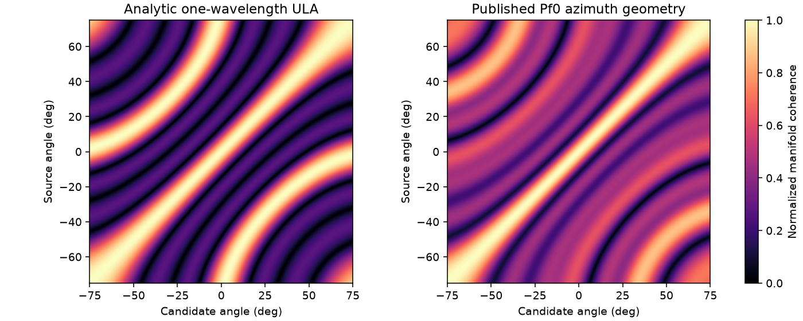

# A100 阵列角度歧义诊断

作者：Keming Yang（[youngkermit8-coder](https://github.com/youngkermit8-coder)）。独立社区项目，遵循仓库 Apache-2.0 许可证；不修改官方工具。

## 为什么需要这个工具

谱峰明显不等于方向唯一。某些阵列在两个相距很远的角度上具有相同导向矢量，单纯argmax仍会给出一个看似确定的角度；拒绝常数谱不能发现这种多峰空间歧义。

工具计算单位范数导向矢量的绝对内积矩阵，排除角距<15°的邻近主瓣，报告每个角度最相似的远端竞争方向。默认相关度阈值0.95用于诊断；另一个函数返回功率达到全局峰值99%的局部峰候选，不把多个候选强行合成一个方向。

```python
import numpy as np
from ambiguity import steering, diagnose, peak_candidates

p = [0, 1, 2, 3]  # 单位：波长
angles = np.arange(-75, 75.1, 0.5)
snapshot = steering(p, [-30])[:, 0]
print(peak_candidates(snapshot, p, angles))  # [-30, 30]
report = diagnose(p, angles)
```

零快拍返回空候选；单通道可能返回整片等高候选，表示无法区分。计算量和矩阵存储为角度网格长度的平方，建议先用适中网格。

## 配置来源和运行

基线提交 `9a41e22b22b981d1500e4a28e056407baeb1027f`。读取 [MATLAB社区工程](../a100-matlab-adc-signal-processing/README.md) 的四份sensor_config_initN.hxx，记录文件SHA。仅支持当前明确单TX、四RX、16行天线坐标布局；Pf0/Pf2选择TX3的四行，Pf1/Pf3选择TX1。此处只取x/波长坐标做零俯仰方位模型，不用真实ADC伪装同步/标定证据。

本次环境：Windows、Python 3.11.15、NumPy 2.4.6、Matplotlib 3.11.2。Python >=3.11；在本目录执行：

```sh
python -m pip install -r requirements.txt
python -m unittest discover -s tests -v
python benchmark.py
```

基准路径相对脚本定位；结果写入 `results/` 并覆盖同名产物。测试和实验无需硬件或网络。

## 实际结果

解析对照中，一波长间距ULA对−30°与+30°的导向矢量内积绝对值为1；半波长间距ULA可分辨这对角度。分别对两方向等量加入固定尺度复高斯噪声，各阵列400次：

| 模型 | argmax误差>15° | 存在远端近等高候选 |
|---|---:|---:|
| 半波长ULA | 0/400 | 0/400 |
| 一波长ULA | 201/400 | 400/400 |
| 公开Pf0方位模型 | 0/400 | 0/400 |

以上是合成模型结果，不是硬件角度误差。四份公开配置在±75°、0.5°网格、至少15°角距下，最大相关度分别约0.87192/0.88244/0.87192/0.88244，均未达到0.95诊断阈值。**这只对选定模型/网格/阈值成立，不保证连续角域、俯仰或真实标定下没有歧义。**

[summary.json](results/summary.json)；[Pf0逐角度竞争方向](results/pf0-angle-diagnostics.csv)。



## 验证和区别

7 项测试覆盖解析空间别名、半波长对照、整体平移/通道排列不变量、单通道不可辨、零/缩放快拍和非法网格。与非均匀阵列FFT实现修复、低幅度DML数值修复及常数谱拒绝不同，本工具诊断的是阵列模型本身的多方向相似性，不修改任何估计器。

真实通道同步、安装俯仰、互耦、通道相位/幅度误差和DDMA解码未验证。没有“消除歧义”算法，也不会自动选中真实目标；调用者应保留多候选或引入独立信息。

## 应用边界补充验证

快拍归一化改用实部/虚部最大绝对分量，再分别缩放，避免有限复数的模长溢出。回归输入每通道为 1.7e308+1.7e308j，旧逻辑将全部角度报告为候选，新逻辑与单位尺度快拍一致、仅返回 0°。原四份配置与 1,200 次合成试验重跑通过，结果不变。该极端输入测试属于数值健壮性，不代表实测 ADC 动态范围。

当前共 7 项测试通过；针对本项的独立回归见 `tests/test_followup.py`。
