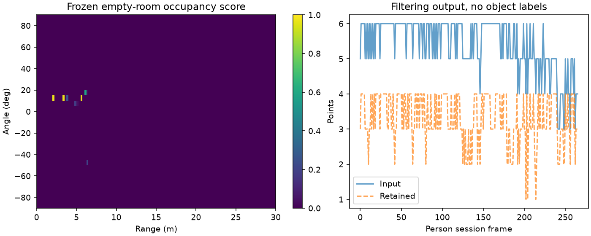

# A100 冻结背景点地图与训练污染边界

作者：Keming Yang（[youngkermit8-coder](https://github.com/youngkermit8-coder)）。独立社区项目，遵循仓库 Apache-2.0 许可证；不修改官方工具。

## 问题与方法

固定房间中的墙面等背景点可能持续触发点数阈值。项目按距离/方位网格学习“某帧是否出现该单元”的频率，同一帧内重复点只计一次，然后冻结模型过滤新观测。过滤本身不更新背景，避免把停留目标悄悄吸收进模型。

默认网格为0.25 m × 5°、距离[0,30) m、角度[-90,90]°；范围外点保留，非法测量拒绝。使用Wilson下界形式的保守分数，z=1.95996，分数>=0.2才标为背景，至少20帧训练。真实帧相关，这个分数**不是经过校准的95%置信保证**，阈值也没有经跨场景优化。

模型可保存/加载JSON，包含网格配置、训练帧数和逐单元命中帧数；加载检查计数范围及形状。重新调用fit是显式重新训练，不是增量学习。

## 数据和复现

基线提交为 `9a41e22b22b981d1500e4a28e056407baeb1027f`。复用 [a100-indoor-cart-mti](../a100-indoor-cart-mti/README.md) 的公开数据，采集与场景说明归原贡献者 yyqdbngt；输入与原 manifest 的 SHA-256 核验，结果保留文件名/哈希。未复制原始大文件，未进行新硬件采集，原固件精确版本未知。

本次环境：Windows、Python 3.11.15、NumPy 2.4.6、Matplotlib 3.11.2。Python >=3.11；在本目录执行：

```sh
python -m pip install -r requirements.txt
python -m unittest discover -s tests -v
python benchmark.py
python pose_stress.py
```

基准路径相对脚本定位；结果写入 `results/` 并覆盖同名产物。测试和实验无需硬件或网络。

基础调用（输入每帧为Nx2，第二列是度，不能直接传日志读取器的弧度列）：

```python
import numpy as np
from background import BackgroundMap

model = BackgroundMap().fit([np.array([[2.0, 0.0]]) for _ in range(30)])
points = np.array([[2.0, 0.0], [3.0, 20.0]])
foreground = points[model.keep(points)]  # 仅第二个点
model.save("model.json")
model = BackgroundMap.load("model.json")
```

## 实际结果

空房间会话前134帧训练，后134帧按时间留出；人员会话266帧完全不参与正式训练。参数在比较前固定，不根据人员结果调整。ROI采用原项目已公布的2.5–3.1 m、−20°–5°，仅作诊断。

| 数据 | 点数前→后 | 原ROI有点帧→过滤后 |
|---|---|---|
| 留出空房间134帧 | 641→47，滤掉92.67% | 0→0 |
| 人员会话266帧 | 1434→876 | 163→163 |

负面对照刻意把全部人员会话加入背景训练，再查询人员数据：ROI仅剩**4帧**有点。这个训练污染示例不是有效评测，说明持续目标会被学成背景。

[summary.json](results/summary.json)、[逐帧结果](results/decisions.csv)、[可复用冻结模型](results/background-model.json)。



## 验证与适用边界

11 项测试覆盖每帧去重、查询不学习、静态目标污染、边界/范围外点、Wilson解析值、模型往返/损坏、非法输入，以及坐标扰动的独立几何预期和固定 ROI 分母。日志读取器沿用本作者占用状态实验的读取逻辑，未将复用部分另算算法创新。

空场留出来自同一次会话，不能代替新场地验证；点被滤掉不等于虚警消除，ROI保留不等于人物识别。雷达移动、角度变化、环境重排、网格边缘抖动和新目标落在旧背景单元均可能使模型失效。应由调用者显式重训或禁用；这里不自动判断环境变化。

## 应用边界补充验证

config 现在返回独立配置副本，不能通过修改读取结果静默改变已训练网格的坐标解释。反例先在 0.25 m 网格训练，再将外部读取的 range_step 改为 1 m，旧代码会把原背景点误保留；现在查询和保存保持原网格。需要不同网格时应新建并重新训练模型。回归及原空场留出/人员/训练污染基准重跑通过。

配置隔离的独立回归见 `tests/test_followup.py`。

## 安装位置敏感性

新增 11 组冻结模型的坐标扰动对照：无扰动时空场 641 点保留 47 点；模拟偏航 ±5° 时保留全部 641 点。人员原 ROI 的 163 帧仍全部保留，不能据此掩盖背景过滤失效。正负偏移影响不对称，未据此设定通用安装容差。完整协议、逐帧记录及图表见 [位置敏感性报告](docs/pose-stress.md)。这不是移动雷达后的实测，也不模拟遮挡或多径变化。
