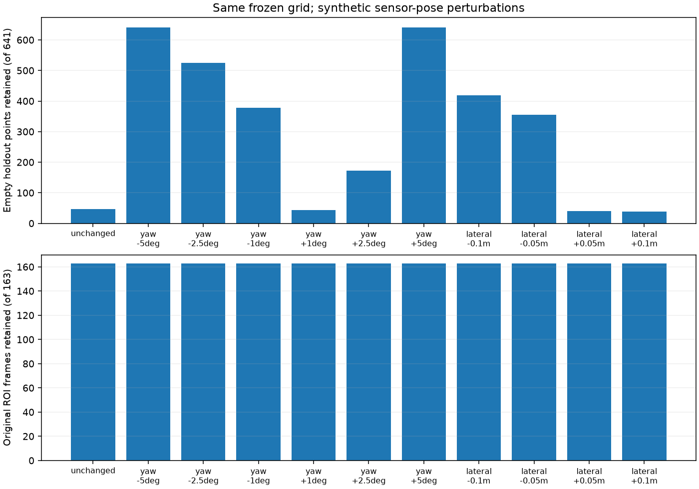

# 冻结背景地图的安装位置敏感性

时间留出验证只能说明原安装坐标下的表现。本实验固定空房间会话前 134 帧训练的模型，对后 134 帧空场及 266 帧人员会话施加声明的坐标扰动，检查旧网格是否还适用。模型、阈值和训练样本均不随结果调整，运行后核对模型计数未改变。

共 11 个条件：原坐标、偏航 ±1°/±2.5°/±5°、沿原坐标 +y 轴平移 ±0.05/±0.1 m。点先由极坐标转换为原坐标 `(x,y)`，减去传感器平移，再旋转到新传感器坐标。零扰动直接保持原值，避免浮点重算将网格边界点划到相邻格。人员 ROI 始终使用原坐标选定的同一批点，避免换分母。

| 声明的扰动 | 留出空场保留点 / 641 | 原人员 ROI 保留帧 / 163 |
|---|---:|---:|
| 无 | 47 | 163 |
| 偏航 −1° / +1° | 378 / 44 | 163 / 163 |
| 偏航 −2.5° / +2.5° | 525 / 173 | 163 / 163 |
| 偏航 −5° / +5° | 641 / 641 | 163 / 163 |
| 平移 −0.05 / +0.05 m | 355 / 40 | 163 / 163 |
| 平移 −0.1 / +0.1 m | 419 / 39 | 163 / 163 |

偏移方向的结果并不对称，不能把“1°”解释成统一的容差。±5° 时旧模型没有过滤掉这批空场中的任何点；人员 ROI 帧全部保留并不能抵消背景过滤失效。这里没有每点物体标签，不能把保留点数解释成虚警数或人物准确率。



这只是对已记录点施加几何变换的敏感性实验，**不是移动雷达后的新采集**；无法模拟可见性变化、遮挡、多径或接收幅度变化。转到 ±90° 范围外的点不夹到边缘网格，保留并单独计数；本次全部条件均为零范围外点。实际移动或重新安装后应重新验证背景模型；这里没有实现自动环境变化检测。

在本项目目录运行：

```sh
python -m unittest discover -s tests -v
python pose_stress.py
```

共 11 项测试通过，新增检查包括独立直角坐标变换预期、范围外点策略及固定 ROI 分母。输入来自 yyqdbngt 的公开会话，逐文件与原 manifest SHA 核验；未复制原始数据。来源、参数和完整统计见 [summary.json](../results/pose-stress/summary.json)，4,400 条逐帧记录见 [frames.csv](../results/pose-stress/frames.csv)。
