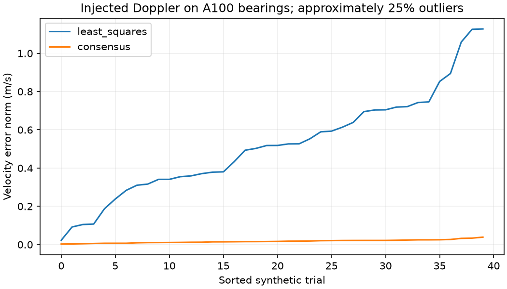

# A100 静态散射体多普勒运动估计实验

作者：Keming Yang（GitHub: [youngkermit8-coder](https://github.com/youngkermit8-coder)）。本项目为独立Community Project，仅新增本目录，遵循仓库Apache-2.0许可证。

## 数据来源与复现环境

使用现有社区项目 [a100-indoor-cart-mti](../a100-indoor-cart-mti/README.md) 的公开A100采集文件：

`../a100-indoor-cart-mti/data/targets/2026_08_02_16_19_35_Tatget_CTLRR-300-V2_1_RawTarget.csv`

该项目标明数据于2026-08-02采集，原采集与场景说明归原贡献者所有。本项目未采集新数据、不复制大文件、不重新声称数据所有权。基线提交为`9a41e22b22b981d1500e4a28e056407baeb1027f`；输入SHA-256记录在结果中。

文件按START/END解析，重复设备帧号保留文件顺序；检查非有限测量、非法ID及负距离，保存不完整帧标记。默认日志207帧、3456条记录，拒绝行和不完整帧均为0。读取器只面向本实验的标记式日志，不替代官方通用解析器。`range`按米、`angle`按度，几何采用官方Python示例的余弦/正弦约定；没有安装姿态或物理真值校准。

本次环境：Windows、Python 3.11.15、NumPy 2.4.6、Matplotlib 3.11.2。不需要连接雷达或付费软件，原采集固件与工具精确版本未知。**合成真值、注入噪声和公开采集数据明确分开；结果不构成产品性能承诺。**

## 运行

在仓库根目录执行：

```sh
python -m pip install -r community/projects/a100-doppler-ego-motion/requirements.txt
python -m unittest discover -s community/projects/a100-doppler-ego-motion/tests -v
python community/projects/a100-doppler-ego-motion/src/study.py
```

入口支持`--input`和`--output`。默认输入相对脚本定位，与工作目录无关。固定实验种子为20261022；默认输出为本项目results目录，会覆盖同名实验产物。算法参数暴露在src/study.py函数接口中；CLI仅选择数据与输出目录，实验默认参数在结果JSON中列出。

结果：[summary.json](results/summary.json)。源码：[study.py](src/study.py)、[logio.py](src/logio.py)。



## 问题与方法

将静态散射体的径向速度写为 `d_i = -[cos(theta_i), sin(theta_i)] v + error_i`。普通最小二乘会受移动目标影响；本实验比较普通最小二乘与固定200次采样的两点共识估计，并在共识集合上重新最小二乘拟合。

共识残差阈值为0.15 m/s。全体及共识集合的设计矩阵条件数超过100时拒绝输出，避免把近乎同方向的观测解释为可靠二维速度。该阈值是实验设计参数，不是行业标准。

合成验证使用公开日志首个至少8点的帧中的17个真实方位角，注入已知速度 `[2, 0.4] m/s`、0.03 m/s标准差噪声，并对4条观测附加随机符号的2 m/s偏移。共40次固定种子试验；4/17约为23.5%，图中称“约25%”。改变的速度均为合成数据。

## 实际运行结果

| 方法 | 40次试验速度误差范数中位数 |
|---|---:|
| 全量最小二乘 | 0.51803 m/s |
| 共识后拟合 | 0.01616 m/s |

原始日志另作模型诊断：207帧均能形成可观测共识，拟合速度中位数为 `[0,0]`。**原始 speed 的物理符号和静态假设没有外部校准，因此这不是本机真实运动速度的验证。** 日志本身也不提供参考运动真值。

## 验证和限制

6 项单元测试覆盖精确恢复、观测重排、离群点、退化角度布局、无效输入和日志边界。图中两条曲线各自排序，横轴不是对应的同一次试验；逐次误差保留在JSON里。

高比例一致运动目标可能形成错误共识；固定噪声阈值不是自适应标定。未估计角速度、滚转/俯仰、垂向速度、安装杆臂或多普勒模糊。二维模型只能用来研究条件成立时的估计与拒绝机制，不是车载里程计产品。后续应使用带真实速度参考、静态背景标注及传感器符号约定的采集验证。

## 应用边界补充验证

RANSAC 后的最小二乘重拟合会移动残差边界。固定种子反例中，旧返回名单含残差 0.13058 m/s 的点，超过设定 0.12 m/s。现在交替重拟合与重新判定内点，只有名单稳定、数量与观测条件满足时才返回；50 次内不收敛则明确失败。回归测试独立检查最终残差名单及该名单上的最小二乘解一致。原 40 次合成实验与 207 帧诊断重跑通过，误差中位数未改变。

当前共 6 项测试通过；针对本项的独立回归见 `tests/test_followup.py`。
