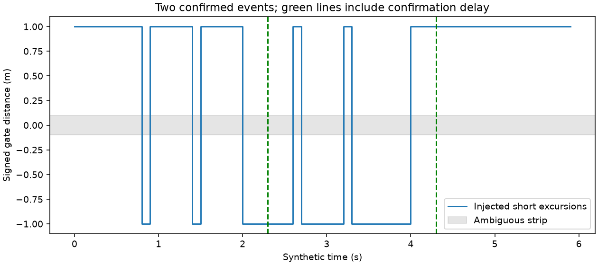

# A100 轨迹下游的定向过线事件计数

作者：Keming Yang（[youngkermit8-coder](https://github.com/youngkermit8-coder)）。独立社区项目，遵循仓库 Apache-2.0 许可证。

每帧输入“持续轨迹 ID → 到门线的有符号距离”，输出已确认的过线事件。该模块位于跟踪器下游，不负责数据关联，不把原始 ObjId 当作持续身份。可用于研究计数逻辑的抖动、重复事件和时间间隔行为。

## 接口与状态规则

```python
from gate import GateCounter

counter = GateCounter(band=0.1, confirm_seconds=0.3, rearm_seconds=0.6, max_gap=0.5)
counter.update(0.0, {"track-a": 1.0})
counter.update(0.3, {"track-a": 0.9})
counter.update(0.4, {"track-a": -0.2})
events = counter.update(0.7, {"track-a": -0.3})
# 一个 negative 事件，time_s=0.7、confirmation_started_s=0.4
```

一条时间戳对应完整的一帧映射；没有轨迹时仍传空映射。正负方向由调用者定义的门线法向决定，可用单位法向 n 和线上一点 p0 计算 `d=n·(p-p0)`。

- ±0.1 m 内为模糊带，打断候选侧确认；不将贴线抖动计为过线。
- 初始一侧和变化后另一侧均需连续观测至少 0.3 s；首次确认一侧不计事件。
- 发出事件后，需要在新稳定侧连续停留 0.6 s 才重新允许事件。模糊带或暂时反向会打断这个重新启用计时；快速真实往返可能被抑制。
- 身份超过 0.5 s 未出现就清除历史。ID 更换、长缺测后复用 ID 均重新建立侧别。
- 时间重复/倒退清空所有状态并递增 `epoch`；非有限时间/距离报错并重置，显式 `reset()` 也递增该字段。每个事件携带所属 epoch，聚合端必须保留该边界。

计时以给定帧时间为准，不能证明观测间连续运动，也没有后台定时线程。输出时刻是确认时刻，不是插值推算的实际过线时刻。

## 复现与证据

Python >=3.11；本次 Windows、Python 3.11.15、NumPy 2.4.6、Matplotlib 3.11.2。在本目录执行：

```sh
python -m pip install -r requirements.txt
python -m unittest discover -s tests -v
python benchmark.py
```

15 项测试覆盖单次过线、抖动、重新启用与快速往返、模糊带打断计时、缺测/ID 复用、两个独立身份同时反向过线、时钟重置、跨 epoch 事件区分和非法参数。实验输出到 `results/`，会覆盖同名文件。

| 合成序列（独立指定两次事件） | 朴素符号变化 | 确认事件 | 两次确认延迟 |
|---|---:|---:|---|
| 无噪声 | 2 | 2 | 均 0.3 s |
| 注入四次短暂反向 | 10 | 2 | 均 0.3 s |



真实数据部分复用 [a100-indoor-cart-mti](../a100-indoor-cart-mti/README.md) 已发布的 `results/motion_trajectory.csv`，原采集与包络提取归 yyqdbngt。基线提交 `9a41e22b22b981d1500e4a28e056407baeb1027f`。这是单条检测包络，**不是身份轨迹，也没有独立事件标注**；这里只检查门线状态机在真实采样间隔和距离值上的输出。SHA-256 记录在 [summary.json](results/summary.json)，没有重新采集或复制原始数据。

| 公开包络 | 样本 | 门线距离 | 简单侧别变化 | 确认事件 |
|---|---:|---:|---:|---:|
| 小推车靠近 | 110 | 2 m | 7 | 1，负向 |
| 小推车远离 | 100 | 2 m | 1 | 1，正向 |
| 人员短距离远离 | 84 | 3.5 m | 1 | **0** |

包络回放的缺测上限为 2 s，其余参数不变。门线和该上限仅为演示配置；人员片段未满足完整确认条件，没有为了得到事件而调整参数。变化次数减少不等于准确率提高。实际多人计数还需要经过验证的跟踪身份、门线外参和逐事件真值；本项目不提供这些上游能力。

## 应用边界补充验证

完整输入帧暂时缺少某个 track ID 时，即使尚未超过 max_gap，也不应算作该轨迹的连续确认或重新就绪时间。现在保留未过期轨迹的稳定侧别，但打断待确认和 rearm 计时；重新出现后重新累计。反例中 0.4 秒开始跨侧、0.5 秒缺席、0.7 秒再出现，旧算法立即计数，新算法等待至 1.0 秒有完整新证据。两项回归覆盖跨侧确认与重新就绪；原合成和公开包络基准重跑通过。

缺测连续性的独立回归见 `tests/test_followup.py`。

## 重启后的事件区分

若设备重启后再次使用同一 track ID 和本地时间，旧事件只有 ID、时刻和方向，两个真实独立事件可能完全相同。新增 `epoch` 从 0 开始，在自动或显式状态重置时递增；即使当前没有过线事件，也可读取 `counter.epoch` 记录边界。普通单轨迹过期不会重置其他轨迹或全局 epoch。

合成对照连续回放两段相同的四帧序列，每段独立发生一次负向过线，都在 0.7 s 确认。按 `(track_id,time_s,direction)` 去重只剩 1 次；加上 epoch 后保留预先声明的 2 次。结果保存在 `results/summary.json` 的 `clock_reset_aggregation`，新增四项回归见 `tests/test_epochs.py`。原合成及公开包络的事件数量和确认时间保持不变。

epoch 只在当前实例生命周期内有效，不能当作跨进程全局事件 ID。持久化或多设备汇总仍需调用方提供独立的 run/source ID；ID 跟踪错误和快速往返漏计也仍存在。
