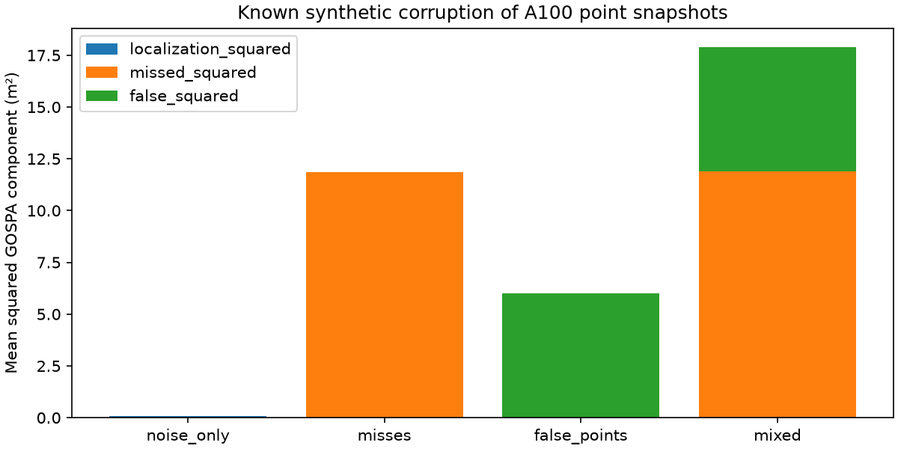

# A100 多目标点集 GOSPA 评估与误差分解

作者：Keming Yang（GitHub: [youngkermit8-coder](https://github.com/youngkermit8-coder)）。本项目为独立Community Project，仅新增本目录，遵循仓库Apache-2.0许可证。

## 数据来源与复现环境

使用现有社区项目 [a100-indoor-cart-mti](../a100-indoor-cart-mti/README.md) 的公开A100采集文件：

`../a100-indoor-cart-mti/data/targets/2026_08_02_16_19_35_Tatget_CTLRR-300-V2_1_RawTarget.csv`

该项目标明数据于2026-08-02采集，原采集与场景说明归原贡献者所有。本项目未采集新数据、不复制大文件、不重新声称数据所有权。基线提交为`9a41e22b22b981d1500e4a28e056407baeb1027f`；输入SHA-256记录在结果中。

文件按START/END解析，重复设备帧号保留文件顺序；检查非有限测量、非法ID及负距离，保存不完整帧标记。默认日志207帧、3456条记录，拒绝行和不完整帧均为0。读取器只面向本实验的标记式日志，不替代官方通用解析器。`range`按米、`angle`按度，几何采用官方Python示例的余弦/正弦约定；没有安装姿态或物理真值校准。

本次环境：Windows、Python 3.11.15、NumPy 2.4.6、Matplotlib 3.11.2; SciPy 1.17.1。不需要连接雷达或付费软件，原采集固件与工具精确版本未知。**合成真值、注入噪声和公开采集数据明确分开；结果不构成产品性能承诺。**

## 运行

在仓库根目录执行：

```sh
python -m pip install -r community/projects/a100-gospa-evaluation/requirements.txt
python -m unittest discover -s community/projects/a100-gospa-evaluation/tests -v
python community/projects/a100-gospa-evaluation/src/study.py
python community/projects/a100-gospa-evaluation/src/cutoff_stress.py
```

入口支持`--input`和`--output`。默认输入相对脚本定位，与工作目录无关。固定实验种子为20261022；默认输出为本项目results目录，会覆盖同名实验产物。算法参数暴露在src/study.py函数接口中；CLI仅选择数据与输出目录，实验默认参数在结果JSON中列出。

结果：[summary.json](results/summary.json)。源码：[study.py](src/study.py)、[logio.py](src/logio.py)。



## 问题与方法

单向最近邻RMSE会忽略漏掉的目标：只保留部分原始点时，该RMSE仍为0。本项目实现固定 `p=2, alpha=2` 的GOSPA，分别报告位置、漏点和虚假点代价。

方法依据 Rahmathullah、García-Fernández、Svensson 的原始论文 [Generalized optimal sub-pattern assignment metric](https://arxiv.org/abs/1601.05585)。这里是独立Python实现，使用SciPy线性分配，不复制论文代码。

截断距离 `c=2 m`，分配成本为 `min(distance,c)^2`。匹配距离小于c的项计入位置平方误差；每个未匹配参考点或估计点贡献 `c²/2`；总距离为三部分平方代价和的平方根。恰好位于c的匹配按“漏点+虚假点”报告，两种表示总成本相等。输入为有限二维点集，拒绝重复位置；日志实验在转换后先去重并记录去重数量。

## 实际运行结果

把207个公开日志点集作为**实验参考快照**，分别生成4种受控扰动：0.05 m标准差位置噪声、按索引移除约三分之一点、增加3个远处点、三者组合。

| 受控扰动 | 平均GOSPA距离 |
|---|---:|
| 仅位置噪声 | 0.28221 m |
| 仅漏点 | 3.44211 m |
| 仅3个虚假点 | 2.44949 m |
| 混合 | 4.23118 m |

漏点案例中，单向最近邻RMSE仍为0，而GOSPA报告非零漏点成本。图展示的是各**平方代价**的平均值，不能将图中柱高直接当作平均距离；平方根与平均运算不能交换。

## 验证和限制

9项测试覆盖空集、单点漏检、截断边界、对称性、顺序不变性及无效输入。小规模随机点集使用穷举全部分配及全部部分匹配作为独立oracle，与SciPy优化结果比较；新增不依赖分配算法的解析排名反转对照。

记录点不等于物理目标真值，本实验评估注入的点集损坏，不代表真实检测准确率；没有目标ID切换或时间连续性评分。不同cutoff会改变位置与数量误差的权衡。算法构造完整代价矩阵，内存复杂度O(NM)，用于离线小规模点集，不用于无界点云流。

## cutoff 敏感性

固定同一批 207 帧参考点与两组扰动，扫描 0.1–4 m 的六个 cutoff。当 c=0.5 m 时，漏掉约三分之一点的平均分 0.86053 低于全部点偏移 0.3 m 的 1.22544；c=1 m 时前者变为 1.72106，排名反转。不能看过结果后挑选对某方案有利的 cutoff。解析对照、完整分解及 2,484 条逐帧评分见 [评估偏好与阈值报告](docs/cutoff-stress.md)。
