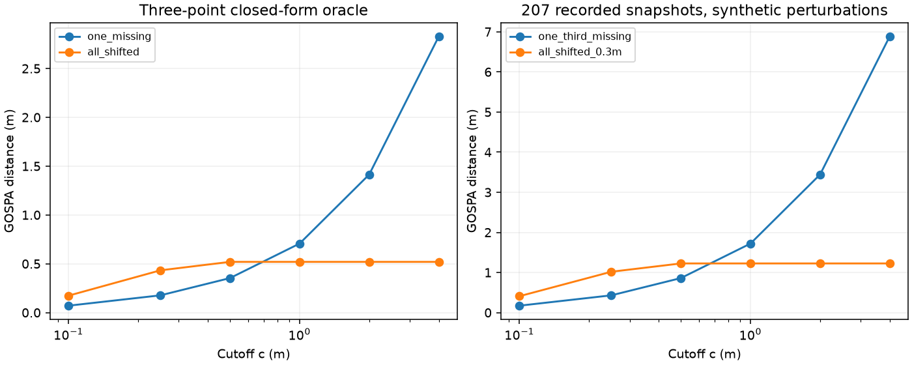

# 截断距离会改变评估偏好

GOSPA 的 cutoff 同时控制可匹配距离及漏点/虚假点成本。只给一个分数而不说明 cutoff，无法判断评估更偏重定位还是数量。本实验固定参考快照和两组估计点，仅扫描预先声明的 `c=0.1,0.25,0.5,1,2,4 m`；不依据结果选择最优 cutoff。

## 不依赖分配算法的解析对照

参考为 `(0,0)、(10,0)、(20,0)` 三点。方案 A 准确保留前两点，方案 B 三点均沿 x 偏移 0.3 m。在本次 cutoff 范围中，各点不会跨目标匹配：

- A 的距离为 `c / sqrt(2)`。
- B 的距离为 `sqrt(3) * min(c, 0.3)`。

`c=0.25` 时 A=0.17678、B=0.43301，A 分数更低；`c=2` 时 A=1.41421、B=0.51962，B 分数更低。输入没有改变，评估偏好发生反转。测试还穷举包含“不匹配任何点”的所有小规模部分匹配，独立核对总代价和三部分分解。

## 207 帧公开点快照上的固定扰动

复用原实验同一份公开 RawTarget，逐文件与原 manifest SHA 校验。对每帧参考点去重后，A 按索引移除约三分之一点，B 全部点沿 x 偏移 0.3 m。6 个 cutoff 共 2,484 条逐帧/方案评分。

| cutoff (m) | A：漏点，平均 GOSPA (m) | B：整体偏移，平均 GOSPA (m) | 平均分更低 |
|---|---:|---:|---|
| 0.1 | 0.17211 | 0.40831 | A |
| 0.25 | 0.43026 | 1.01816 | A |
| 0.5 | 0.86053 | 1.22544 | A |
| 1 | 1.72106 | 1.22544 | B |
| 2 | 3.44211 | 1.22544 | B |
| 4 | 6.88423 | 1.22544 | B |



点快照不是物理目标真值，两个方案是受控数值扰动，不是真实检测器。不能据此建议某个 cutoff 用于所有场景；实际评估应先按应用代价确定协议。不同 cutoff 的分数不可直接混合排名。输出分别保留平均距离与平均平方代价分解，不能将二者混为一谈。

在仓库根目录运行：

```sh
python -m unittest discover -s community/projects/a100-gospa-evaluation/tests -v
python community/projects/a100-gospa-evaluation/src/cutoff_stress.py
```

共 9 项测试通过。结果及来源见 [summary.json](../results/cutoff-stress/summary.json)，逐帧分解见 [frames.csv](../results/cutoff-stress/frames.csv)。输入来自 yyqdbngt 的公开采集；未新增硬件数据，未复制原始文件。
