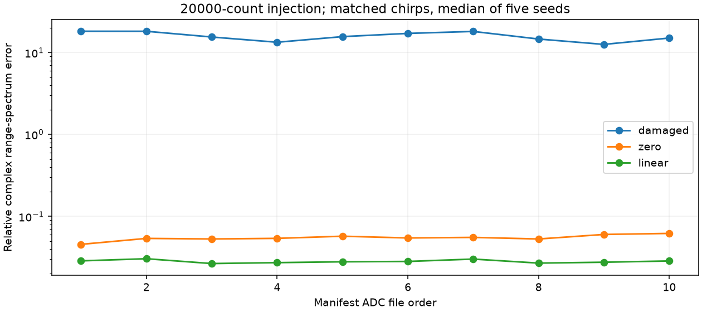

# A100 ADC 短脉冲干扰检测与保守修复

作者：Keming Yang（[youngkermit8-coder](https://github.com/youngkermit8-coder)）。独立社区项目，遵循仓库 Apache-2.0 许可证；不修改官方工具。

## 方法与接口

对每个chirp独立计算中位数及1.4826×MAD，以8倍尺度检测异常样本；尺度下限为1 ADC count，不做逐文件增益归一化。只有内部短段才支持线性插值或置零对照。异常段>8样本、总异常比例>5%或触及任一边界时，整个chirp返回NaN，并在usable中明确拒绝。

```python
from mitigate import mitigate

# adc: [chirp, sample]，有限实数
repaired, sample_mask, usable = mitigate(adc, method="linear")
# 后续处理必须检查usable，并保留原chirp时间/序号：
kept_samples = repaired[usable]
kept_times = original_times[usable]
```

不能把拒绝chirp直接接入FFT，也不能删除后重新编号来假装采样均匀。函数不识别干扰来源，不保证可以恢复丢失的真实波形。

## 数据与运行

基线提交为 `9a41e22b22b981d1500e4a28e056407baeb1027f`。复用 [a100-indoor-cart-mti](../a100-indoor-cart-mti/README.md) 的公开数据，采集与场景说明归原贡献者 yyqdbngt；输入与原 manifest 的 SHA-256 核验，结果保留文件名/哈希。未复制原始大文件，未进行新硬件采集，原固件精确版本未知。

10份带三字段头的ADC经过严格批量加载：高16位优先有符号解包；长度、uint32范围和单零尾部检查。加载器只服务本实验格式，不重复发布通用完整性审计功能。

本次环境：Windows、Python 3.11.15、NumPy 2.4.6、Matplotlib 3.11.2。Python >=3.11；在本目录执行：

```sh
python -m pip install -r requirements.txt
python -m unittest discover -s tests -v
python benchmark.py
```

基准路径相对脚本定位；结果写入 `results/` 并覆盖同名产物。测试和实验无需硬件或网络。

## 实验设计和结果

以原始采样作为数值参考，分别在32个随机chirp内部注入3样本脉冲，幅度±200/2000/8000/20000 count，截到int16范围；每文件每幅度5个固定种子，共200次注入实验。原始数据不保证无干扰，注入形态也不代表真实射频干扰分布。

三种处理都在**同一组可用且被注入的chirp**上计算相对复数距离谱L2误差，先使用相同Hann窗/rFFT，避免不同剔除分母制造改善。结果为每幅度50个文件/种子组合的中位数：

| 注入幅度 | 检出的注入样本 / 总数 | 不处理误差 | 置零误差 | 线性插值误差 |
|---|---:|---:|---:|---:|
| 200 | 1 / 4800 | 0.15825 | 0.15825 | 0.15825 |
| 2000 | 4800 / 4800 | 1.58254 | 0.05513 | 0.02824 |
| 8000 | 4800 / 4800 | 6.33015 | 0.05513 | 0.02824 |
| 20000 | 4800 / 4800 | 15.82538 | 0.05513 | 0.02824 |

弱脉冲几乎完全漏检，这个边界保留在报告中。未注入的10份原始数据共0个样本被标记；这仅表示本次参数没有修改它们，不能解释为真实误报率为零。

[完整逐文件/逐种子结果](results/summary.json)。



## 验证与限制

7项测试覆盖独立直线插值预期、干净输入恒等、每chirp独立尺度、边缘拒绝、长段/高比例拒绝、置零与严格ADC解包。未改动原始文件。方法只处理突出的短时离群点，不处理持续窄带干扰、未知丢样或真实饱和恢复；强合法瞬态可能被误当异常，高频真实波形的线性插值可能失真。拒绝数量必须随误差一起报告，不保证CFAR或硬件检测性能。
