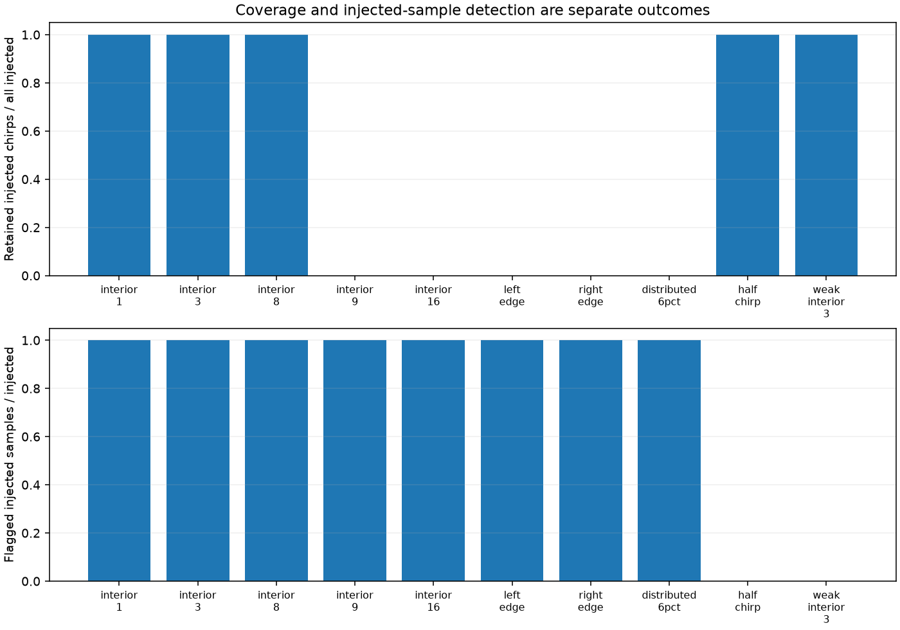

# 检出、可用覆盖率和修复误差需要一起报告

原实验固定三采样点宽度，主要比较幅度。本实验补上宽度、位置和污染占比：同样的 10 份公开 ADC，每份固定选择 32 个 chirp（种子 20261022），在全部条件中复用这些索引，共 100 个文件/条件组合、3,200 条被注入 chirp 的记录。

强扰动为正向 20,000 count 加性脉冲并裁剪到 int16；弱扰动为 200 count。内部连续段放在 chirp 中心；左右边缘分别接触首尾样本；6% 条件均匀分散于内部，不形成长连续段；半 chirp 条件修改中间 50% 的样本。所有条件均为人工注入，不能当作真实射频干扰分布。

| 条件 | 被标记的注入样本 / 全部注入样本 | 保留的注入 chirp / 320 | 线性修复谱误差中位数 |
|---|---:|---:|---:|
| 内部 1 点 | 320 / 320 | 320 | 0.02593 |
| 内部 3 点 | 960 / 960 | 320 | 0.04345 |
| 内部 8 点 | 2,560 / 2,560 | 320 | 0.07560 |
| 内部 9 点 | 2,880 / 2,880 | 0 | 不计算 |
| 内部 16 点 | 5,120 / 5,120 | 0 | 不计算 |
| 左边缘 3 点 | 960 / 960 | 0 | 不计算 |
| 右边缘 3 点 | 960 / 960 | 0 | 不计算 |
| 分散污染 6% | 19,840 / 19,840 | 0 | 不计算 |
| **半 chirp 强污染** | **0 / 163,840** | **320** | **330.43862，无改善** |
| 弱内部 3 点 | 0 / 960 | 320 | 0.24994，无改善 |

三个误差方法始终使用同一组保留的注入 chirp；一组全部拒绝时 JSON 记为 `null`，不能写成“误差为零”。中位数是 10 个文件的各自相对复数距离谱 L2 误差的中位数，不是逐样本误差中位数。原始波形是数值参考，不保证无干扰。短段修复的损失与完全拒绝造成的覆盖率损失分别可见。

**`usable=True` 不能解释为干净。** 半 chirp 污染改变了中位数和 MAD，阈值随之升高，所有污染样本均漏检。`max_run` 和 `max_fraction` 只约束已经被检测器标出的样本，无法拦截这种未被标记的长污染。本实验保留原参数，未为某个失败案例调参。



原始索引保留在 [chirps.csv](../results/burst-stress/chirps.csv)，不得把删掉拒绝行后的序号当成均匀慢时间。若后续需要 Doppler，必须显式处理缺采样；本实验没有评价 Doppler 或检测准确率。未注入位置没有被误标，也没有拒绝未注入 chirp，只是这些条件下的结果，不是硬件误报率保证。

在本项目目录运行：

```sh
python -m unittest discover -s tests -v
python burst_stress.py
```

共 11 项测试通过，新增独立检查注入位置与裁剪、原数组不变、空比较集、分散脉冲几何，以及平坦信号上 50% 污染的 MAD 失败案例。10 份输入与原 manifest SHA 校验，原采集归 yyqdbngt；[summary.json](../results/burst-stress/summary.json) 包含来源、全部方法误差、拒绝数和逐文件结果。
