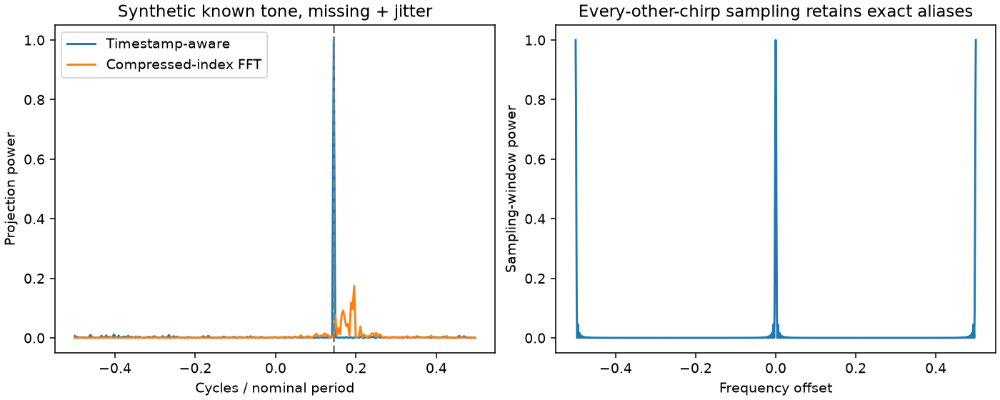

# A100 不规则慢时间的频谱投影与混叠诊断

作者：Keming Yang（[youngkermit8-coder](https://github.com/youngkermit8-coder)）。独立社区项目，遵循仓库 Apache-2.0 许可证；不修改官方工具。

## 问题和数值契约

缺失chirp后压缩数组并按连续索引做FFT，会改变时间轴。这里提供显式时间戳的非均匀傅里叶投影：

`S(f)=sum(w[n]*x[n]*exp(-2j*pi*f*(t[n]-t[0])))/sum(w)`。

输入为一维复数序列、严格递增时间、频率网格和可选非负权重。输出相位以**首个保留样本**为原点；比较另一实现的复数谱时必须统一原点。时间以秒输入则频率为Hz；以名义chirp间隔输入则是cycles/period。输出是加权相干幅度，不是标定的功率谱密度。

频率分块计算以限制临时矩阵，复杂度仍为O(N×F)，不会比FFT更快；不自动估计时间戳、窗函数或Nyquist区间。采样窗函数另行输出，用于暴露混叠。

```python
import numpy as np
from spectrum import spectrum, sampling_window

t = np.array([0.0, 0.7, 1.3, 2.2, 4.8, 6.1, 8.0])
x = np.exp(2j * np.pi * 0.173 * t)
f = np.linspace(-0.5, 0.5, 1001)
estimated = f[np.argmax(abs(spectrum(x, t, f)))]
window_power = sampling_window(t, f)
```

## 数据与复现

基线提交为 `9a41e22b22b981d1500e4a28e056407baeb1027f`。复用 [a100-indoor-cart-mti](../a100-indoor-cart-mti/README.md) 的公开数据，采集与场景说明归原贡献者 yyqdbngt；输入与原 manifest 的 SHA-256 核验，结果保留文件名/哈希。未复制原始大文件，未进行新硬件采集，原固件精确版本未知。

本次环境：Windows、Python 3.11.15、NumPy 2.4.6、Matplotlib 3.11.2。Python >=3.11；在本目录执行：

```sh
python -m pip install -r requirements.txt
python -m unittest discover -s tests -v
python benchmark.py
```

基准路径相对脚本定位；结果写入 `results/` 并覆盖同名产物。测试和实验无需硬件或网络。

真实ADC只使用名义chirp索引，丢样掩码为人工施加，没有测得真实时间抖动，不换算物理速度或推断DDMA。每份文件选择去慢时间均值后能量最大的非DC距离bin，规则不使用场景标签。

## 实验结果

合成已知频率37/256 cycles/period，256个名义chirp保留192个；每条件40个掩码。第二条件另注入±0.3周期的时间抖动，信号也在这些非均匀时刻生成。

| 合成条件 | 时间戳投影峰频误差中位数 | 压缩索引FFT误差中位数 |
|---|---:|---:|
| 随机缺失25% | 0 | 0.0390625 |
| 随机缺失25% + 时间抖动 | 0 | 0.03515625 |

这组真值恰在频率网格上，零误差不意味着无限分辨率。原样本时刻缺失但仍在整数网格时，正确归一化的保位补零FFT与此投影**数学等价**。10份真实数据人工缺失实验的独立FFT oracle最大相对误差为1.59e-14，没有宣称优于正确补零FFT。

每隔一个chirp保留一次的采样窗在偏移−0.5、0、+0.5处功率均为1，仍存在精确混叠；时间戳信息不能恢复采样本身丢失的可辨识性。

[完整结果](results/summary.json)。



## 验证与边界

7项测试覆盖完整/加权FFT等价、真实非均匀已知频率、缺失首样本时的相位原点、规则抽取别名、时移/分块不变量、非法时间与权重。ADC批量读取器与本作者脉冲实验共享相同严格格式逻辑。

本项目是时间明确时的离线频谱工具，不是缺失采样恢复器。多目标、非平稳运动、相位不连续、频率网格选择、长缺口和幅度窗均会影响结果；实际设备需要可靠chirp时刻和已确认的发射模式。
