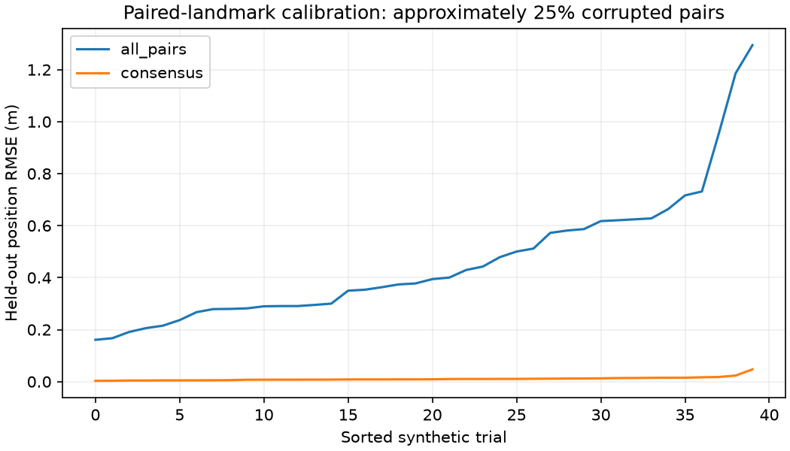

# A100 二维地标刚体标定与错配鲁棒性实验

作者：Keming Yang（GitHub: [youngkermit8-coder](https://github.com/youngkermit8-coder)）。本项目为独立Community Project，仅新增本目录，遵循仓库Apache-2.0许可证。

## 数据来源与复现环境

使用现有社区项目 [a100-indoor-cart-mti](../a100-indoor-cart-mti/README.md) 的公开A100采集文件：

`../a100-indoor-cart-mti/data/targets/2026_08_02_16_19_35_Tatget_CTLRR-300-V2_1_RawTarget.csv`

该项目标明数据于2026-08-02采集，原采集与场景说明归原贡献者所有。本项目未采集新数据、不复制大文件、不重新声称数据所有权。基线提交为`9a41e22b22b981d1500e4a28e056407baeb1027f`；输入SHA-256记录在结果中。

文件按START/END解析，重复设备帧号保留文件顺序；检查非有限测量、非法ID及负距离，保存不完整帧标记。默认日志207帧、3456条记录，拒绝行和不完整帧均为0。读取器只面向本实验的标记式日志，不替代官方通用解析器。`range`按米、`angle`按度，几何采用官方Python示例的余弦/正弦约定；没有安装姿态或物理真值校准。

本次环境：Windows、Python 3.11.15、NumPy 2.4.6、Matplotlib 3.11.2。不需要连接雷达或付费软件，原采集固件与工具精确版本未知。**合成真值、注入噪声和公开采集数据明确分开；结果不构成产品性能承诺。**

## 运行

在仓库根目录执行：

```sh
python -m pip install -r community/projects/a100-landmark-calibration/requirements.txt
python -m unittest discover -s community/projects/a100-landmark-calibration/tests -v
python community/projects/a100-landmark-calibration/src/study.py
```

入口支持`--input`和`--output`。默认输入相对脚本定位，与工作目录无关。固定实验种子为20261022；默认输出为本项目results目录，会覆盖同名实验产物。算法参数暴露在src/study.py函数接口中；CLI仅选择数据与输出目录，实验默认参数在结果JSON中列出。

结果：[summary.json](results/summary.json)。源码：[study.py](src/study.py)、[logio.py](src/logio.py)。



## 问题与方法

研究已知对应地标的平面刚体变换 `target = R source + t`。基线通过中心化坐标的交叉协方差SVD求最小二乘旋转和平移，并显式约束 `det(R)=+1`，避免把镜像当旋转。

鲁棒版本固定采样200组三点对应关系，使用0.12 m残差阈值形成共识，再在共识集合重新估计。两组坐标必须有限、至少3个点，且各自中心化后的秩为2。本实验保守拒绝共线布局；并不声称二维刚体变换在任意共线点上数学上都不可识别。

公开日志首个至少8点的帧提供17个源地标的几何分布。目标坐标由12°旋转、`[0.4,-0.2] m`平移和0.02 m标准差噪声**合成**，4/17对应被加入2 m标准差错配偏移。100个独立生成的留出位置用于评估，绝不拿拟合内点残差代替验证误差。固定种子重复40次。

## 实际运行结果

| 方法 | 留出位置RMSE中位数 |
|---|---:|
| 全部对应关系SVD拟合 | 0.38592 m |
| 共识后SVD拟合 | 0.00880 m |

## 验证和限制

6项测试包括90°已知变换、逆变换、离群点恢复、镜像约束、退化几何和日志边界。图的两条误差序列独立排序；JSON保留每次试验值。

这不是实际雷达—相机外参标定：没有真实配对标定板、相机内参或时间同步信息。地标位置分布取自公开日志，目标位置、变换、扰动和真值全部由实验生成。它实现了已有标定场景设想中可单独验证的二维配准步骤，不宣称解决三维标定、自动关联或时间同步。共识少于3点时失败；高比例结构化错配仍可能给出错误结果。阈值需由真实标定测量误差决定。
