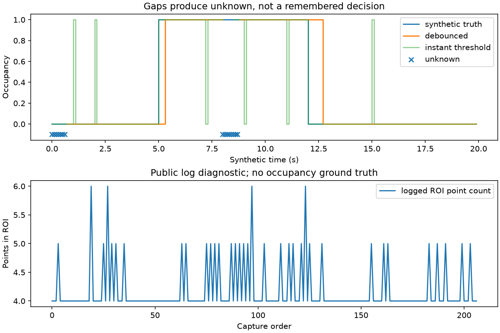
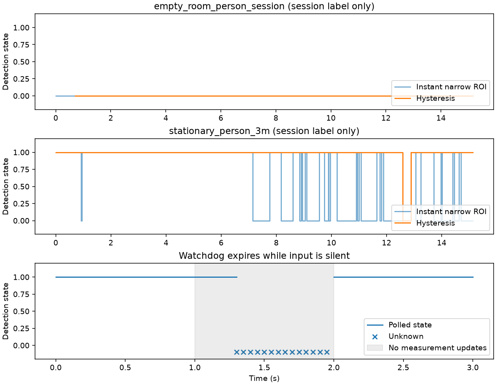

# A100 ROI 占用状态的时间防抖与失联处理

[采集时间新鲜度深化](docs/capture-freshness.md)：可选外部时钟映射与误差界，解决递增旧缓存绕过顺序检查的问题。六组传输实验同时报告过期包、unknown 代价、轮询延迟和错误映射的失败案例；当前共 33 项测试通过。

新增[八场景应用回放](docs/application-cases.md)：复用五组公开实测会话，并明确注入断流、迟到/重复包、设备重启三种故障。应用层区分本地接收时钟和设备时钟，拒绝旧包续期，记录 occupied/clear/unknown 状态事件。五组实测共 2,902 帧；这是一个集中完善的应用案例，不是八个独立算法。推车场景的窄 ROI 迁移失败也保留在结果中。

作者：Keming Yang（GitHub: [youngkermit8-coder](https://github.com/youngkermit8-coder)）。本项目为独立Community Project，仅新增本目录，遵循仓库Apache-2.0许可证。

## 数据来源与复现环境

使用现有社区项目 [a100-indoor-cart-mti](../a100-indoor-cart-mti/README.md) 的公开A100采集文件：

`../a100-indoor-cart-mti/data/targets/2026_08_02_16_19_35_Tatget_CTLRR-300-V2_1_RawTarget.csv`

该项目标明数据于2026-08-02采集，原采集与场景说明归原贡献者所有。本项目未采集新数据、不复制大文件、不重新声称数据所有权。基线提交为`9a41e22b22b981d1500e4a28e056407baeb1027f`；输入SHA-256记录在结果中。

文件按START/END解析，重复设备帧号保留文件顺序；检查非有限测量、非法ID及负距离，保存不完整帧标记。默认日志207帧、3456条记录，拒绝行和不完整帧均为0。读取器只面向本实验的标记式日志，不替代官方通用解析器。`range`按米、`angle`按度，几何采用官方Python示例的余弦/正弦约定；没有安装姿态或物理真值校准。

本次环境：Windows、Python 3.11.15、NumPy 2.4.6、Matplotlib 3.11.2。不需要连接雷达或付费软件，原采集固件与工具精确版本未知。**合成真值、注入噪声和公开采集数据明确分开；结果不构成产品性能承诺。**

## 运行

在仓库根目录执行：

```sh
python -m pip install -r community/projects/a100-occupancy-hysteresis/requirements.txt
python -m unittest discover -s community/projects/a100-occupancy-hysteresis/tests -v
python community/projects/a100-occupancy-hysteresis/src/study.py
python community/projects/a100-occupancy-hysteresis/src/validate_presence.py
python community/projects/a100-occupancy-hysteresis/src/application_cases.py
python community/projects/a100-occupancy-hysteresis/src/freshness_cases.py
```

入口支持`--input`和`--output`。默认输入相对脚本定位，与工作目录无关。固定实验种子为20261022；默认输出为本项目results目录，会覆盖同名实验产物。算法参数暴露在src/study.py函数接口中；CLI仅选择数据与输出目录，实验默认参数在结果JSON中列出。

结果：[summary.json](results/summary.json)。源码：[study.py](src/study.py)、[logio.py](src/logio.py)。



## 问题与方法

逐帧点数阈值容易因孤立噪点、单帧漏点频繁跳变；固定帧数防抖又依赖采样率。本项目使用真实采集时间的持续时长确认状态，并把未知状态作为一等输出。

默认进入条件：ROI点数>=2持续0.3秒；退出条件：点数<=0持续0.7秒。中间点数保持已有状态，但打断正在确认的持续时间。超过0.25秒没有相邻有效观测、时间重复/倒退、未闭合帧或缺失时间都重置为unknown；恢复后重新积累证据。

应用必须主动轮询 `value_at(now)`，它在完全没有新输入时也会检查最后观测的有效期，超时返回 `None`（unknown）。轮询不更新最后观测时间，也不推进进入/退出确认；只有新观测才能确认状态。`update` 和 `value_at` 必须使用同一时间基准，例如都用本地单调时钟；不能混用日志相对时间与系统时间。模块没有后台线程，轮询周期决定超时之后多久能被发现。

```python
machine = Occupancy(enter_seconds=0)
machine.update(0.0, 2)  # True
machine.value_at(0.2)  # True，尚未过期
machine.value_at(0.3)  # None，无需等待下一条输入
```

ROI用示例坐标 `X=r*cos(angle),Y=r*sin(angle)` 定义：X在[1,5] m、Y在[-2,2] m。原始ObjId不被当作跨帧身份，也不做人数/车辆数估计。

## 实际运行结果与取舍

合成序列长20秒、采样间隔0.1秒，5~12秒为占用，包含孤立误报、短漏报及8~8.5秒缺测。

| 指标 | 结果 |
|---|---:|
| 瞬时阈值跳变次数（缺测按false计，仅作朴素基线） | 16 |
| 防抖已知状态之间跳变次数 | 2 |
| 防抖已知状态覆盖率 | 92.5% |
| 双方都已知且有输入的公共样本 | 185 |
| 防抖在公共样本上的误判数 | 10 / 185 |
| 瞬时阈值在公共样本上的误判数 | 6 / 185 |
| 防抖 unknown / 瞬时阈值无输入 | 15 / 5 |

**防抖减少跳变但增加进入/退出延迟，所以公共样本上的误判数反而更多。** 误判数已使用同一个公共样本集合；unknown单独报告，不能当作正确。CSV给出每个时间点真值、输入和输出，可自行重新统计延迟与覆盖率。跳变次数的朴素基线仍把缺测当 false，仅作诊断，不与已知状态跳变直接比较性能。

公开日志有207帧：201个占用输出、0个clear、6个unknown。公开场景没有ROI占用真值，这些仅为算法输出分布，不是检测性能。已有静态背景点足以触发ROI计数，因此真实部署需要背景抑制和带标注验证。

## 验证和限制

10项测试覆盖不均匀采样、持续时间而非帧数、缺测、主动断流轮询、轮询不延长有效期、不代替观测确认、ROI边界、时钟倒退、中间计数打断确认、无效配置和日志边界。结果包含 `synthetic-decisions.csv` 和 `logged-decisions.csv`，unknown显式写出。

这里没有安全控制或人物识别功能。主动失联处理由应用定期调用 `value_at`，模块本身不调度告警。默认持续时间与ROI是实验参数，需要按任务的响应延迟和误报代价验证。

## 固定 ROI 的空房间／有人场景对照

新增验证直接使用原项目已公布的 `2.5–3.1 m、−20°–5°` ROI，不做参数搜索。输入为同目录原始 RawTarget 的 `2026_08_02_19_13_58` 空房间会话和 `2026_08_02_21_35_30` 约3米静止人员会话，分别268/266帧；逐文件 SHA 与原 manifest 校验，结果记录完整文件名及哈希。原采集和ROI来源归 yyqdbngt。

窄ROI参数：有至少1个点立即进入，连续无点0.7秒退出，缺测上限0.25秒。宽ROI保持原算法参数。**这比较的是点检测持续性，场景描述只是弱标签，不是逐帧人物/ROI真值。** 延时保持可以掩盖漏点，同时也会延迟真实离开；这里没有真实进出事件标注。

| 场景及方法 | 总帧 | occupied | clear | unknown |
|---|---:|---:|---:|---:|
| 空房间，原宽ROI | 268 | 263 | 0 | 5 |
| 空房间，窄ROI瞬时 | 268 | 0 | 268 | 0 |
| 空房间，窄ROI防抖 | 268 | 0 | 256 | 12 |
| 静止人员，原宽ROI | 266 | 261 | 0 | 5 |
| 静止人员，窄ROI瞬时 | 266 | 163 | 103 | 0 |
| 静止人员，窄ROI防抖 | 266 | 260 | 6 | 0 |

窄ROI两方法在空房间共有256个已知帧，均无与会话标签不一致的输出；在人员会话共有266个已知帧，与会话标签不一致分别103/6帧。这个差异包含人为退出延迟，不应表述为人员识别准确率提升。宽ROI空场也触发，说明单纯点数不能判别人。

独立时钟实验在1.0秒后完全停止 `update`，每0.05秒轮询：1.30秒第一次返回unknown，2.0秒新输入恢复后重新确认。0.25秒是有效期，轮询只在严格超过有效期时过期。

结果：[presence-validation.json](results/presence-validation.json)、[逐帧决策](results/presence-decisions.csv)。


