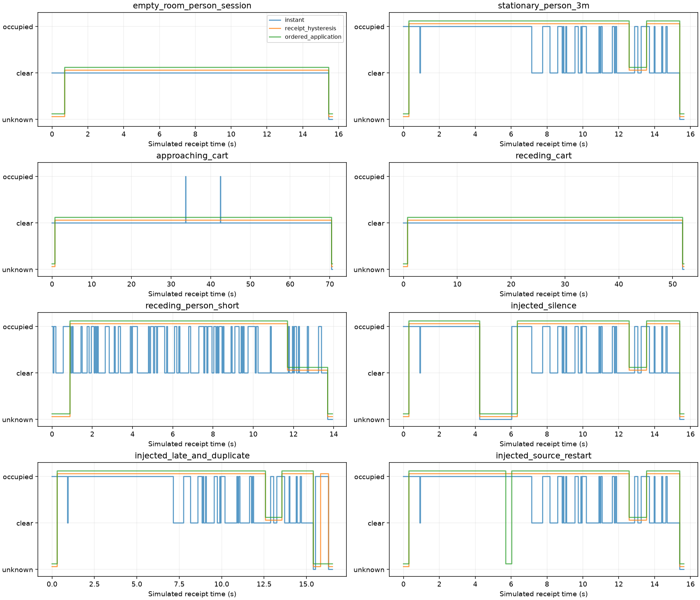

# 从单个防抖函数到八场景应用回放

作者：Keming Yang / youngkermit8-coder。

本次对照 [yyqdbngt 的室内低速目标案例](../../a100-indoor-cart-mti/README.md) 的证据组织方式：明确场景、来源、基线、复现步骤、结果和失败条件。复用原作者于 2026-08-02 采集的 A100 RawTarget；没有新增实机采集，不复制原始文件。原项目使用了真实雷达与独立采集条件，本项目的传输时钟和三类故障是模拟，证据范围不同。

## 应用问题

单纯调用防抖函数不能处理数据通道的全部状态。日志设备时钟与应用接收时钟通常不是同一个起点；旧包可能延迟到达，重复包也可能在输入停止后持续到达。如果每个收到的包都更新有效期，旧数据就可能让过期状态重新变为 occupied。

新增 `src/application.py` 包装原 `Occupancy`，保持原 API 不变：

| 输入 | 应用行为 |
|---|---|
| 有效且设备时间严格增加 | 在本地接收时钟上更新防抖 |
| 设备时间重复或更小 | 拒绝，不更新有效期，不自动推断重启 |
| 完全没有新包 | 调用者轮询；超过 0.25 s 后 unknown |
| 不完整帧或非法点 | 清空状态为 unknown，不当作空场 |
| 有效的零点帧 | 作为 count=0 参与退出确认 |
| 外部确认设备重启 | `start_epoch(now)` 清空状态并增加 epoch |
| 旧 epoch 的在途包 | 拒绝，不能进入新会话 |
| 本地时钟倒退/非有限 | 清空状态并抛错，调用方需修复计时来源 |

重启必须来自可信的应用生命周期信号，例如设备重新连接；只看到时间倒退无法区分迟到包和真正重启。接收适配器必须保留包所属 epoch，不能把缓存旧包重新标成新 epoch。本例没有实现硬件连接适配器。

```python
import numpy as np
from application import OccupancyApplication

app = OccupancyApplication(enter_count=1, enter_seconds=0.3)
points = np.array([[2.8, 0.0, 0.0]])  # 米、弧度、米每秒
app.observe(0.0, 86400.0, points, epoch=0)
app.observe(0.2, 86400.2, points, epoch=0)
app.observe(0.4, 86400.4, points, epoch=0)  # occupied
app.poll(0.7)  # unknown；轮询不会续期或推进确认
epoch = app.start_epoch(1.0)["epoch"]
app.observe(1.1, 0.0, points, epoch=epoch)  # 新一轮确认
```

## 固定实验协议

ROI 沿用原案例公布的 `2.5–3.1 m、−20°–5°`，包括边界；没有根据推车结果重新选择 ROI。点数至少 1 持续 0.3 s 才进入，零点持续 0.7 s 才退出；有效期 0.25 s，轮询 0.05 s。与旧 `validate_presence.py` 的立即进入参数不同，本报告不混用两次结果。

三个方法接收相同的数据包和时钟事件：

1. `instant`：瞬时点数阈值，具有同样的本地接收有效期。
2. `receipt_hysteresis`：时间防抖和有效期，但不检查设备顺序和会话 epoch。
3. `ordered_application`：完整应用包装。

实测回放的接收时刻由文件相对时间模拟；不能据此声称测量了真实网络延迟。按到达时刻排序，同刻先处理重启、再处理包、最后轮询。每组在最后收到包后继续轮询 0.5 s，记录尾部过期状态。结果按事件之间的持续时间积分，不能用不同采样频率下的帧数冒充时长。过期在下一次轮询或接收事件被发现，因此检测延迟最多再加一个轮询周期。

`unknown` 单独计时。只有空房间和静止人员使用采集说明作为会话弱标签，并在三方法共同已知时段比较不一致时长；这些不是逐帧人物/ROI 真值。运动场景和故障注入不给准确率。

## 八个案例的实际结果

单位为秒。每行第三列按 occupied / clear / unknown 排列，总和等于该案例完整回放时长。全部原始统计、事件原因和输入 SHA-256 在 JSON 中。

| 案例 | 输入与用途 | 应用状态时长 | 结论及限制 |
|---|---|---|---|
| 空房间 | 268 个实测帧，空场对照 | 0 / 14.744 / 0.914 | 此窄 ROI 没有 occupied；包含启动和末尾 unknown |
| 约 3 米静止人员 | 266 个实测帧，检测持续性 | 14.126 / 0.970 / 0.535 | 瞬时 occupied 为 9.410 s；延时保持会增加 occupied，不能叫识别率 |
| 推车靠近 | 1,226 个实测帧，ROI 迁移检查 | 0 / 69.715 / 0.961 | 瞬时仅 0.109 s 有点；窄 ROI 不能直接用于推车应用 |
| 推车远离 | 904 个实测帧，ROI 迁移检查 | 0 / 51.087 / 1.000 | 窄 ROI 完全未触发；不把 clear 解释成推车不存在 |
| 人员远离 | 238 个实测帧，退出保持诊断 | 10.810 / 1.997 / 1.131 | 瞬时 occupied 为 4.821 s；没有人工离开时刻，不能计算退出误差 |
| 注入断流 | 删除人员会话 [4,6) s 的 35 个包 | 12.029 / 0.970 / 2.632 | 4.250 s 进入 unknown，恢复新证据后 6.347 s 重新 occupied |
| 注入迟到和重复包 | 延迟原第 30 帧；末尾重复发送第 20 帧六次（均为零基序号） | 14.126 / 0.970 / 1.435 | 拒绝 7 个旧包；普通防抖被重复包重新确认，多出 0.469 s occupied |
| 注入设备重启 | 第 100 帧开始新 epoch，另插入旧 epoch 在途包 | 13.792 / 0.970 / 0.869 | 5.703 s 立即 unknown，6.037 s 重新确认，拒绝 1 个旧 epoch 包 |

人员弱标签比较的公共已知时长是 15.096 s；瞬时法与会话标签不一致 5.990 s，两个防抖方法均为 0.970 s。这个差异包含退出延迟，不能转写成人员识别准确率。推车两例是保留的负面迁移结果，不是通过了通用目标检测验证。



图中三条曲线在纵轴略作错开便于比较，三种状态的含义不变。

## 复现与证据

在仓库根目录运行：

```sh
python -m pip install -r community/projects/a100-occupancy-hysteresis/requirements.txt
python -m unittest discover -s community/projects/a100-occupancy-hysteresis/tests -v
python community/projects/a100-occupancy-hysteresis/src/application_cases.py
```

也可指定 `--source /path/to/a100-indoor-cart-mti --output /path/to/results`。生成程序覆盖同名结果文件，不修改原数据。五个源文件都先对照原 manifest 校验 SHA，合计 2,902 帧、41,884 个点；没有随机采样。故障定义固定在 `build_cases`，不根据运行输出选择触发时刻。

- [summary.json](../results/application/summary.json)：输入哈希、环境、参数、八组结果、注入定义和状态事件。
- [receipts.csv](../results/application/receipts.csv)：每个到达包的原始帧序号、设备时间、epoch、接受/拒绝原因。
- [timeline.csv](../results/application/timeline.csv)：三个方法在每个接收/轮询事件上的状态，包含显式 unknown。

本轮在 Windows、Python 3.11.15、NumPy 2.4.6、Matplotlib 3.11.2 运行。24 项测试（原 10 项和新增 14 项）覆盖时钟分离、旧包不续期、重启重新确认、跨 epoch 拒绝、不完整/空帧区分、轮询不能确认、ROI 边界、持续时间统计及回放事件顺序。

## 未解决的应用边界

- 窄 ROI 属于特定静止人员场景。推车结果明确表明它不是通用占用区域；需新场景的安装标定和区域定义。
- 点计数不提供身份、人数、类型或安全控制能力；这里没有新的采集或人工逐帧标注。
- 设备时间严格递增只是排序条件。单调递增的整段旧缓存仍可能被视为新包；没有设备到本地时钟映射，就不能保证绝对数据新鲜度。
- 接收端持续确认依赖收到的时间分布；压缩回放或网络积压可能改变确认行为，不能当作真实物理持续时间证明。
- 例子是单线程回放/API，事件列表保存在内存中；长期服务需要外部调度、持久化和日志轮转。
