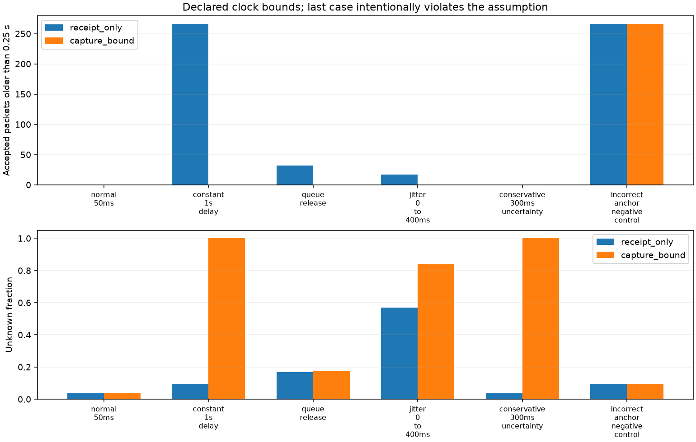

# 数据仍在到达，不代表数据仍然新鲜

本次深化已有占用应用的接入边界：设备时间严格递增的一批旧缓存，可以通过重复/乱序检查，并不断更新基于接收时间的有效期。这个问题与点云检测算法无关，单靠防抖无法消除。

## 可选时钟契约

`CaptureClock` 接受外部已经建立的设备时钟—本地单调时钟映射：设备锚点、本地锚点、秒数比例 `rate`、锚点误差 `error_seconds`、相对漂移上限 `drift_ppm`。误差随着远离锚点而增长，并加上浮点运算舍入余量。它不从包到达时间估计同步关系，也不能验证调用方提供的误差界是否可信。

对设备时刻 d，映射中心是 `local_anchor + (d-device_anchor)*rate`。误差为锚点误差、累计漂移及舍入余量之和，得到可能采集区间 `[L,U]`。应用要求：

- `now < L`：这个包在所给映射下还没有采集，拒绝；不污染已接受包的顺序水位。
- `now > L + max_gap`：无法在最坏误差下保证新鲜，拒绝。
- 接受后有效期截止于 `L + max_gap`，不能再从接收时刻重新延长完整有效期。

如果真实采集时刻落在 `[L,U]` 中，上述接受条件可以排除超过 `max_gap` 的包。**该结论以外部时钟映射正确为前提。** 返回值增加 `freshness_basis` 和 `fresh_until_s`，供调用者审计与安排下一次轮询。`fresh_until_s` 是最近有效观测的期限，不能把它当成 occupied 判定；仍需读取 `state`。

```python
from application import CaptureClock, OccupancyApplication

# 仅为模拟示例：这两个锚点和误差不能直接用于真实设备。
mapping = CaptureClock(device_anchor=10000, local_anchor=0,
                       error_seconds=0.01, rate=1, drift_ppm=100)
app = OccupancyApplication(capture_clock=mapping, enter_count=1)
# observe(received_at, device_time, Nx3_points, epoch=...)
# 持续调用 poll(local_monotonic_now)，其中所有本地时间使用相同单调时钟。

# 外部确认重启后，必须提供新会话映射。
app.start_epoch(20, capture_clock=CaptureClock(0, 20, error_seconds=0.01))
```

已开启采集时间检查的实例，如果重启时未提供新映射，会保持 unknown 并拒绝后续观测，不静默退回接收时间模式。原来不提供 `capture_clock` 的调用方式保持兼容，仅提供接收有效期，仍不识别整批有序旧缓存。

## 六组可复现实验

原始点帧来自 yyqdbngt 的公开 `a100-indoor-cart-mti` 静止人员会话，266 帧；沿用既有 ROI 与防抖参数。输入 SHA 与原 manifest 核验。**点测量是实测，物理采集时刻、传输延迟及同步映射是本实验声明的模拟真值，没有新增网络或硬件测量。**

每种方法看到相同的包和 0.05 s 轮询时刻。回放保留全部包，按到达时间排序；不先去掉迟到包给某种方法创造优势。固定种子为 20261022。

| 场景 | 注入方式 | 接收时间模式接受旧包 | 采集时间约束接受旧包 | 采集时间模式 unknown 时长 |
|---|---|---:|---:|---:|
| 正常延迟 | 每包 50 ms | 0 | 0 | 0.635 s |
| 整批旧缓存 | 每包延迟 1 s，时间戳仍递增 | 266 | 0 | 16.631 s，整个回放 |
| 队列积压释放 | [4,6) s 采集的包在 6 s 后按 50 倍速释放 | 32 | 0 | 2.731 s |
| 随机抖动 | 每包独立延迟 0–400 ms，保留自然乱序 | 17 | 0 | 13.349 s |
| 过宽但有效的误差界 | 延迟 50 ms，时钟误差界 ±300 ms | 0 | 0 | 15.681 s，整个回放 |
| **错误映射负面对照** | 实际延迟 1 s，却把映射中心偏移 +950 ms、只声明 ±10 ms | 266 | **266** | 1.585 s |

“旧包”由注入的真实采集时刻独立判断：到达年龄超过 0.25 s；不使用被测试映射计算这个标签。正常、积压和抖动三组采用 ±10 ms 映射误差界。实际物理时间刚好处于映射中心，属于界内验证，不是时钟误差分布的统计抽样。

**错误映射组是明确失败案例。** 新方法也会接受全部 266 个旧包，显示已知状态的 15.046 s 全部超过真实有效期。它证明同步前提不能从算法本身获得保证。

**可用性也有代价。** 抖动组的 unknown 从 9.056 s 增至 13.349 s；47 个物理上较新的包也被拒绝，其中包含已有的顺序约束和保守误差约束。误差界 ±300 ms 大于 0.25 s 有效期时，266 个实际只延迟 50 ms 的包都被保守拒绝。不能只报告旧包降为零，而隐藏无法判定的时间。



## 轮询延迟单独报告

应用没有后台计时器，上一状态在两次轮询之间仍可能被界面保持。报告因此同时统计：

1. 每次观测/轮询完成时，是否仍返回已经过期的已知状态。
2. 如果界面保持上一状态，连续时间上超过真实采集期限的时长。

有效映射的五组实验中，新模式在观测/轮询完成时没有返回过期已知状态；这不等于连续时间过期显示严格为零。例如正常延迟组仍有 **0.019 s** 轮询等待，抖动组累计 **0.0565 s**。调用方应按响应预算安排轮询或使用返回的有效期更新显示；这里不提供硬实时保证。

## 复现、测试与产物

在仓库根目录执行：

```sh
python -m unittest discover -s community/projects/a100-occupancy-hysteresis/tests -v
python community/projects/a100-occupancy-hysteresis/src/application_cases.py
python community/projects/a100-occupancy-hysteresis/src/freshness_cases.py
```

33 项测试通过，含新增 9 项：仿射映射与漂移误差、递增旧包、按采集期失效、保守拒绝、未来时间不污染顺序水位、重启映射要求、旧模式兼容、参数校验和独立回放真值检查。既有八场景回放已重跑，旧模式的状态统计保持不变。

- [summary.json](../results/freshness/summary.json)：六组完整统计、映射参数、种子、输入来源和哈希。
- [receipts.csv](../results/freshness/receipts.csv)：每个包的真实注入年龄、接受原因、有效期与模式。
- [timeline.csv](../results/freshness/timeline.csv)：双方每个事件后的状态与最近接受采集时刻，可独立重算时长。

结果仍不证明人物识别、持续物理占用或硬件时钟同步能力。防抖持续时间仍基于接收时间；本次解决的是在已知时钟误差界下排除过期数据。真实设备需要额外建立并验证映射，安装 ROI 与场景迁移问题也仍然存在。
