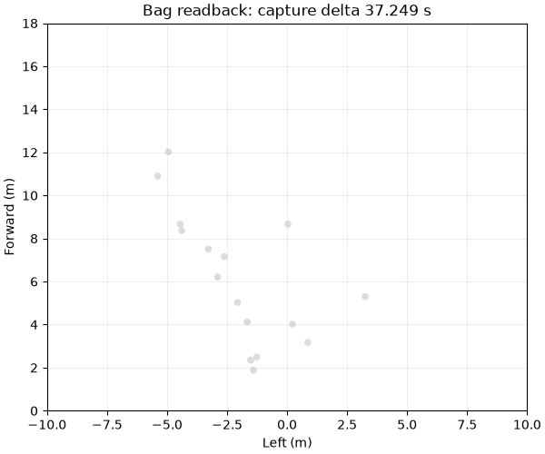

# A100 RawTarget → PCD / ROS2 PointCloud2 离线导出

作者：Keming Yang（[youngkermit8-coder](https://github.com/youngkermit8-coder)）。独立社区项目，遵循仓库 Apache-2.0 许可证。

把带 START/END 的 A100 RawTarget 日志转换为逐帧 binary PCD、ROS2 SQLite bag 和审计 manifest。输入帧顺序、重复设备帧号、空帧及未闭合帧都保留；数字测量的非法行计数写入上下文。输出通过独立 PCD 读取库和 bag 读取器逐帧读回，再从反序列化后的 bag 点云生成回放图。

## 运行

本次环境：Windows、Python 3.11.15、NumPy 2.4.6、rosbags 0.11.9、pypcd4 1.5.1、Matplotlib 3.11.2。Python >=3.11；无需安装 ROS 或连接硬件。在本目录运行：

```sh
python -m pip install -r requirements.txt
python -m unittest discover -s tests -v
python validate_dataset.py
python export_clouds.py ../a100-indoor-cart-mti/data/targets/2026_08_02_16_19_35_Tatget_CTLRR-300-V2_1_RawTarget.csv exported-static
```

目标目录必须不存在，不覆盖旧导出。时间和 float32 可表示性在创建目录前检查；文件系统写入失败仍可能留下不完整目录，请另选目录重试。验证脚本的完整 PCD/bag 在临时目录中读回后清理，仅把小型 JSON、PNG 和 GIF 留在 `results/`，重复运行会覆盖这些结果。

## 数据来源与结果

复用 [a100-indoor-cart-mti](../a100-indoor-cart-mti/README.md) 的全部 7 份 RawTarget，原采集及场景说明归 yyqdbngt。基线提交 `9a41e22b22b981d1500e4a28e056407baeb1027f`，每份输入与原 manifest 的 SHA-256 核验。未复制大文件、未新增硬件采集。

6 项单元测试通过：坐标轴、空帧、重复设备帧号、跨午夜时间、uint32 最大 ID、非法记录/未闭合帧、时间缺失/倒退、float32 溢出和不覆盖已有目录。全部 **3320 帧、49524 个点**完成 PCD 与 bag payload 的逐字段一致性校验，同时检查 header 时间、PointField 类型/偏移、步长及上下文消息。

验证记录见 [summary.json](results/summary.json)。80 帧靠近小推车片段从 bag 读回后生成下图；GIF 固定 10 fps 展示，不声称还原硬件帧率。这里没有运行 `ros2 bag play`、RViz 或实机订阅器，不能据此声称所有 ROS 发行版兼容。



## 字段、坐标与时间契约

| 字段 | PCD / PointField | 单位或含义 |
|---|---|---|
| x, y, z | float32 | m；`x=r*cos(angle), y=r*sin(angle), z=0` |
| radial_speed | float32 | m/s，保留输入符号；不是笛卡尔速度分量 |
| range | float32 | m，原始距离 |
| angle | float32 | 度，原始方位角 |
| object_id | uint32 | 原始帧内 ObjId，不保证跨帧身份 |

每点 28 bytes，小端紧密排列；`frame_id=a100_radar_planar`。坐标按原项目极坐标约定转换为前方 x、左方 y；这是显式的可视化约定，没有外参/安装姿态标定。z=0 表示二维平面占位，不表示测得零高度。只导出有限、非负距离和合法 ID 的测量；其他诊断文本跳过。

`/a100/points` 使用 `sensor_msgs/msg/PointCloud2`，Humble 类型定义，rosbags writer 的 bag metadata version 9。`/a100/frame_context` 使用 `std_msgs/msg/String` JSON，包含文件顺序、设备帧号、完整标志、拒绝数字行数和源墙钟时间。下游若要求完整帧，必须读取该上下文并过滤，不能只看点云。

bag 时间与 header 时间都为“记录墙钟相对首帧的差值 + 1 秒”，保持日志间隔并避开零时间；没有时区、UTC 或硬件时钟保证。缺失、相等或倒退的时间直接拒绝，应由调用者明确拆分为单调会话，不用猜测间隔修补。无 TF、传感器外参或强度标定；导出文件主要用于离线算法交换和回放验证。
