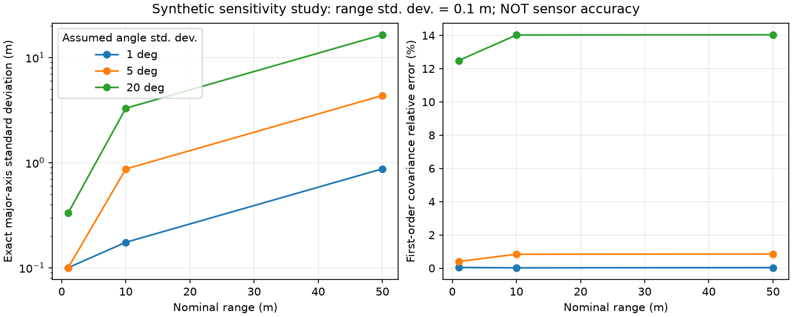

# A100 点云极坐标误差传播实验

作者：Keming Yang（GitHub: [youngkermit8-coder](https://github.com/youngkermit8-coder)）。

本独立 Community Project 用仓库公开的 CTSAI-A100 目标日志作为距离、角度样本，研究：相同的角度误差，在不同距离会产生多大的平面位置不确定性？跟踪和聚类实验中的固定米制门限为什么不一定适合所有距离？一阶 Jacobian 近似什么时候开始偏离精确矩？

**所有噪声标准差均为用户设定的假设，不是从日志估计的雷达精度。** 本项目没有采集新硬件数据，不提供标定结果、真实目标置信区间、跟踪性能或产品能力承诺。

## 数据与环境

- 输入来自现有社区项目 `../a100-indoor-cart-mti/data/targets/2026_08_02_16_19_35_Tatget_CTLRR-300-V2_1_RawTarget.csv`。该项目 README 将这些文件标为 2026-08-02 的 A100 实测数据；采集与场景说明归原贡献者所有。本项目只引用文件，不复制或重新声称采集。
- 基线仓库提交：`9a41e22b22b981d1500e4a28e056407baeb1027f`。运行结果保存源文件 SHA-256，便于识别数据变化。
- `range` 按米、`angle` 按度解释，沿用官方 Python 示例 `X=range*cos(angle), Y=range*sin(angle)` 的绘图约定。没有验证安装坐标系，也不使用日志已有的 X/Y 列作为真值。
- 本次环境：Windows，Python 3.11.15，NumPy 2.4.6，Matplotlib 3.11.2；也通过 NumPy 2.4.3 核心测试。核心实验只依赖 NumPy；可选绘图依赖 Matplotlib。
- 原始采集固件、RadarTools 精确版本未知；本实验不要求连接雷达。

## 运行

在仓库根目录执行：

```sh
python -m pip install -r community/projects/a100-polar-uncertainty/requirements.txt
python -m unittest discover -s community/projects/a100-polar-uncertainty/tests -v
python community/projects/a100-polar-uncertainty/src/study.py
```

可选生成图像：

```sh
python -m pip install matplotlib
python community/projects/a100-polar-uncertainty/src/study.py --plot
```

输入、输出路径可用 `--input`、`--output` 指定，默认路径相对脚本解析，不依赖工作目录。`--sigma-range` 和 `--sigma-angle-deg` 修改真实日志上的条件误差假设；合成实验仍固定为 0.1 m 距离标准差，并扫描 1/5/20 度，以便重复比较。`--samples` 设置每个合成案例的样本数（至少 1000）。随机种子固定记录在 JSON 内。

## 模型与验证

令 R 与 T 独立，分别服从 N(r, sr²)、N(t, st²)，其中 st 使用弧度。设 q=st²，e=exp(-q)，旋转矩阵 Q 的列为径向和切向单位向量。

```text
E[X,Y] = r exp(-q/2) [cos(t), sin(t)]
Var_radial = r² (1-e)² / 2 + sr² (1+exp(-2q)) / 2
Var_tangential = (r²+sr²) (1-exp(-2q)) / 2
Cov_exact = Q diag(Var_radial, Var_tangential) Qᵀ
Cov_linear = Q diag(sr², r² st²) Qᵀ
```

公式由高斯特征函数 `E[exp(i k T)]=exp(i k t-k² st²/2)` 和独立性推得。使用 `expm1` 保留极小角度噪声下的数值精度。这里的“精确”仅指该假设模型下的前两阶矩；变换后的分布一般不是高斯分布，不能把标准差椭圆当作有保证的 95% 覆盖区域。

九个合成案例分别进行 100,000 次抽样。测试使用另一个固定种子和每案例 200,000 次抽样验证精确协方差；还检查零噪声、90度旋转、小角度极限、无效参数、重复设备帧号和未闭合末帧。

## 已运行结果

完整机器可读结果见 [summary.json](results/summary.json)、[synthetic.csv](results/synthetic.csv)。

公开日志解析出 **207 个帧、3456 条有效目标记录**，未闭合帧与被拒绝目标行均为 0。距离中位数 6.40 m，95%分位数 12.98 m。在假设 `sr=0.1 m, st=1°` 时，逐记录精确协方差最大特征值开方的中位数为 **0.11170 m**，95%分位数为 **0.22652 m**。这是样本集合上的条件敏感性分布，不是独立目标统计量或实测误差。

| 合成距离 | 假设角度标准差 | 精确最大轴标准差 | 一阶协方差相对误差 |
|---:|---:|---:|---:|
| 10 m | 1° | 0.17452 m | 0.0201% |
| 50 m | 1° | 0.87253 m | 0.0335% |
| 50 m | 20° | 16.44207 m | 14.0370% |

相对误差使用 Frobenius 范数。九个案例中 Monte Carlo 与精确协方差的最大相对误差约 **0.660%**。20°是检验线性近似边界的合成压力案例，不代表 A100 的正常测角误差。



## 边界与后续用途

- 仅支持带 `ObjId,range,angle` 表头及 START/END 的日志。按文件顺序读取目标，不用设备帧号去重，不进行轨迹身份推断；时间戳和采集元数据不参与此实验。
- 拒绝非有限距离/角度、负距离、非法数值 ID；缺失 END 的帧保留已有数据并计入 `incomplete_frames`。空文件/无有效记录会失败。此轻量读取器不代替官方通用日志解析器。
- 高斯距离允许负抽样值，近原点时不符合物理距离模型。JSON 报告 `range < 5*sr` 的记录数；当前默认输入为0。相关、非高斯、系统偏差、安装偏角、遮挡、多径均未建模。
- 未对同一物体跨帧记录做独立性假设，不通过样本数缩小不确定性。
- 可用于解释距离相关门限和位置权重的设计动机；实际调整跟踪器之前仍需标定噪声、验证关联性能和失效情况。
- 所有新增内容只在本项目目录，不修改官方工具或其他人的社区项目。代码遵循仓库 Apache-2.0 许可证。
