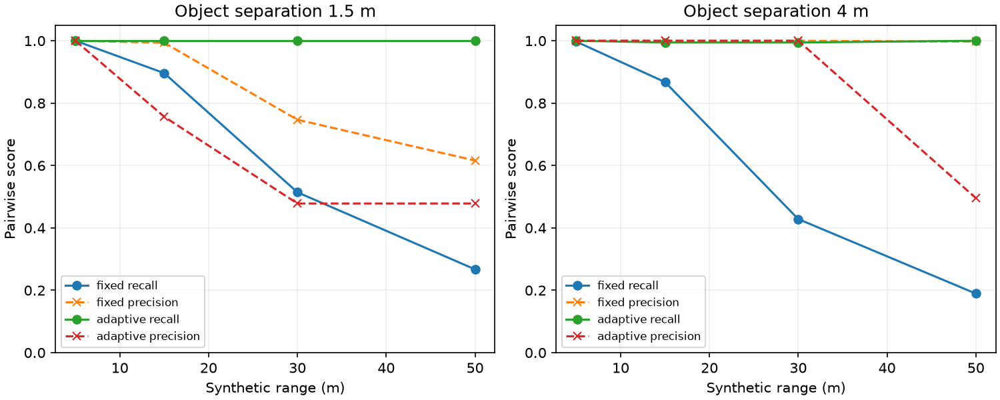

# A100 距离自适应密度聚类的漏聚与合并边界

作者：Keming Yang（GitHub: [youngkermit8-coder](https://github.com/youngkermit8-coder)）。本项目为独立Community Project，仅新增本目录，遵循仓库Apache-2.0许可证。

## 数据来源与复现环境

使用现有社区项目 [a100-indoor-cart-mti](../a100-indoor-cart-mti/README.md) 的公开A100采集文件：

`../a100-indoor-cart-mti/data/targets/2026_08_02_16_19_35_Tatget_CTLRR-300-V2_1_RawTarget.csv`

该项目标明数据于2026-08-02采集，原采集与场景说明归原贡献者所有。本项目未采集新数据、不复制大文件、不重新声称数据所有权。基线提交为`9a41e22b22b981d1500e4a28e056407baeb1027f`；输入SHA-256记录在结果中。

文件按START/END解析，重复设备帧号保留文件顺序；检查非有限测量、非法ID及负距离，保存不完整帧标记。默认日志207帧、3456条记录，拒绝行和不完整帧均为0。读取器只面向本实验的标记式日志，不替代官方通用解析器。`range`按米、`angle`按度，几何采用官方Python示例的余弦/正弦约定；没有安装姿态或物理真值校准。

本次环境：Windows、Python 3.11.15、NumPy 2.4.6、Matplotlib 3.11.2。不需要连接雷达或付费软件，原采集固件与工具精确版本未知。**合成真值、注入噪声和公开采集数据明确分开；结果不构成产品性能承诺。**

## 运行

在仓库根目录执行：

```sh
python -m pip install -r community/projects/a100-range-adaptive-clustering/requirements.txt
python -m unittest discover -s community/projects/a100-range-adaptive-clustering/tests -v
python community/projects/a100-range-adaptive-clustering/src/study.py
```

入口支持`--input`和`--output`。默认输入相对脚本定位，与工作目录无关。固定实验种子为20261022；默认输出为本项目results目录，会覆盖同名实验产物。算法参数暴露在src/study.py函数接口中；CLI仅选择数据与输出目录，实验默认参数在结果JSON中列出。

结果：[summary.json](results/summary.json)。源码：[study.py](src/study.py)、[logio.py](src/logio.py)。



## 问题与方法

角度噪声引起的切向位置散布随距离增大。固定半径密度聚类可能在远处把同一对象拆成噪点；扩大邻域又可能合并相邻对象。本项目用明确的合成标签同时测量这两种错误，不把召回提高单独当作改进。

基线邻域为欧氏距离<=0.3 m。自适应邻域按每个点的径向/切向构造协方差 `C_i`：径向标准差0.12 m，切向标准差 `max(range*1°,0.12 m)`，角度换算成弧度。两点使用对称距离 `deltaᵀ(C_i+C_j)^(-1)delta <= 2²`。这是依赖假设噪声的邻域，不宣称真实置信门限。

密度扩展规则：包含自身的邻居数至少4为核心点，只从核心点扩展；边界点可归入簇，但不会连接两个核心连通分量。模糊边界点归属可能依赖输入次序，簇编号本身没有物理意义。

合成场景有两个对象，每个12点；距离扫描5/15/30/50 m，横向分离扫描1.5/4 m，距离噪声0.12 m、角度噪声1°，每组30次。逐点对统计precision、recall和噪点比例；噪点不当作一个共同簇。无预测同簇点对时precision按0报告。

## 实际运行结果与负面发现

50 m、对象相隔4 m时：

| 方法 | 点对precision | 点对recall |
|---|---:|---:|
| 固定邻域 | 0.9973 | 0.1894 |
| 自适应邻域 | 0.4957 | 1.0000 |

**自适应邻域恢复了同对象点对，但也把不同对象合并了，不能宣称整体更准确。** 1.5 m分离的场景更早出现这种失效。完整8组配置、两种方法的结果保留在JSON和图中，没有删除不利配置。

公开日志另作未标注诊断，两种方法每帧簇数的中位数均为0：默认参数与该稀疏实测点集不匹配，因此没有报告实测聚类准确率。该结果说明合成点数和真实检测稀疏度之间存在明显差异。

## 验证和限制

8 项测试覆盖双簇与噪点、非核心边界点不能桥接核心分量、旋转不变性、空输入、无效输入和日志边界。使用完整N×N邻接矩阵，内存O(N²)，面向离线小场景。

噪声尺度未标定，不处理相关误差、扩展目标形状、杂波链桥接和跨帧身份。后续应先获取真实对象标签，再比较不同gate与min_samples的precision/recall曲线；不能只提高gate来追求召回。

## 应用边界补充验证

评估函数明确规定 truth=-1 是背景噪点，不是一个共同真实对象。旧算法把两个 -1 噪点聚成一簇也计为正确点对，混合反例 precision 被错误算成 1；现在为 0.5，recall 仍为 1。全背景被误聚成一簇时 precision/recall 均为 0，并校验标签长度及整数取值。原真实日志和全部合成配置重跑通过；原实验没有 truth=-1，因此原表格数值不变。

当前共 8 项测试通过；针对本项的独立回归见 `tests/test_followup.py`。
