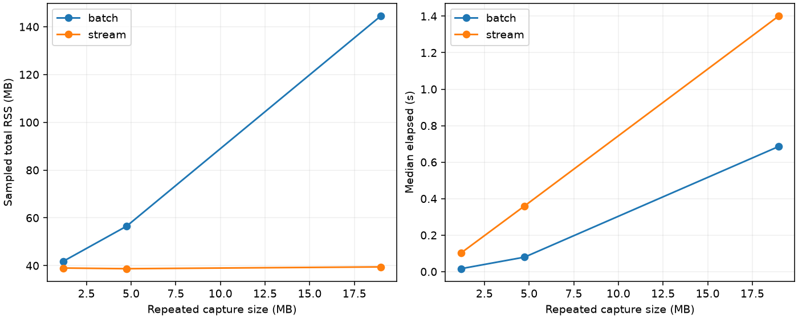

# A100 ADC 文本的有界内存距离功率统计

作者：Keming Yang（[youngkermit8-coder](https://github.com/youngkermit8-coder)）。独立社区项目，遵循仓库 Apache-2.0 许可证。

## 解决的问题

长 ADC 文本一次读入、转整数、展开采样和 FFT 会同时保留多份数组。本项目每次读 64 KiB 文本，按 8 chirp 块展开高 16 位优先的有符号采样，累计每个距离 bin 的平均功率。固定采样数和块大小时，工作内存不随 chirp 总数增长。代价是 Python 严格分词比 NumPy 批量加载慢。

输入只支持已验证的 `Rx,samples,chirps,<uint32 words>,[0]` 格式：Rx0–3、偶数采样数 2–65536、正 chirp 数；尾部最多一个零填充，允许最后一个逗号。截断、负数、超范围整数、内部空字段及多余尾部都会报错。不会用补零掩盖损坏输入，也不推断其他设备格式。

输出是对每个 chirp 加对称 Hann 窗后，未归一化 rFFT 模平方的算术平均（包括 DC 和 Nyquist）。单位为未标定的 ADC count²；没有将 bin 换算成物理距离。它不保留慢时间相位，不能替代完整 Range-Doppler、MTI 或多通道角度处理。

## 数据与环境

复用 [a100-indoor-cart-mti](../a100-indoor-cart-mti/README.md) 的 10 份真实 ADC 文本，来源和场景归原贡献者 yyqdbngt；不复制数据，不声称新增采集。基线提交 `9a41e22b22b981d1500e4a28e056407baeb1027f`，逐文件 SHA-256 在 [结果](results/summary.json) 中，并与原项目 manifest 校验。

本次运行：Windows、Python 3.11.15、NumPy 2.4.6、psutil 7.2.2、Matplotlib 3.11.2。Python >=3.11；无需硬件。

在本目录执行：

```sh
python -m pip install -r requirements.txt
python -m unittest discover -s tests -v
python benchmark.py
python src/stream_adc.py ../a100-indoor-cart-mti/data/adc/adc_approaching_box_rx0_20260802163233093/run_001_Pf0_Rx0.txt --output profile.json --block-chirps 8
```

CLI 输出覆盖指定 JSON 文件；`--block-chirps` 支持 1–256。基准脚本覆盖 `results/` 中同名报告，扩展输入在临时目录生成并清理。

## 运行结果

7 项单元测试通过，覆盖带符号高/低半字、跨读取块 token、尾逗号、末尾不足一个块、独立数值预期、损坏输入和边界配置。10 份真实采集与独立批量解码/FFT 的最大相对误差均低于 `1e-12`。

性能实验将同一真实 payload 重复 1、4、16 次，只增加 chirp 数；这些是合成扩展输入，不是新采集。每种方法每个长度启动 3 个全新进程，耗时取中位数，RSS 取 3 次采样峰值的最大值。RSS 每 1 ms 采样，包含解释器和库内存，可能漏掉很短的峰值，不能当作精确的分配器峰值。

| 输入长度 | 批量 RSS MB | 流式 RSS MB | 批量时间 s | 流式时间 s |
|---|---:|---:|---:|---:|
| 1× | 41.74 | 38.99 | 0.016 | 0.102 |
| 4× | 56.50 | 38.70 | 0.079 | 0.360 |
| 16× | 144.54 | 39.46 | 0.686 | 1.401 |



流式方案在本机长输入上节约内存但更慢；具体性能取决于机器、文件缓存和块大小。数据加载正确性与性能基准分开验证；批量 oracle 只处理已通过 SHA 校验的正常文件，不作为容错加载器发布。
